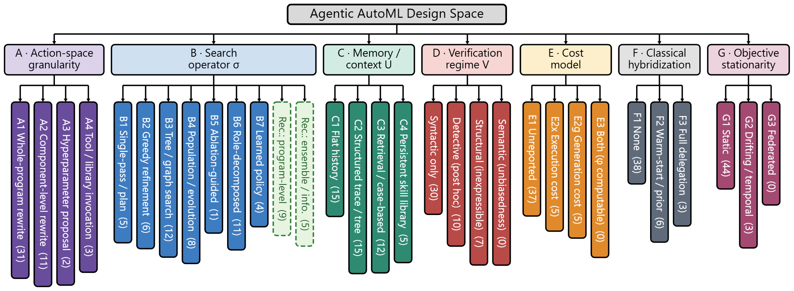
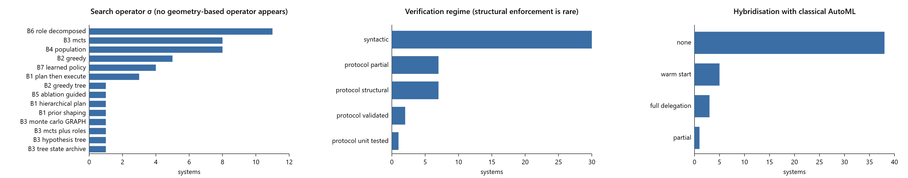
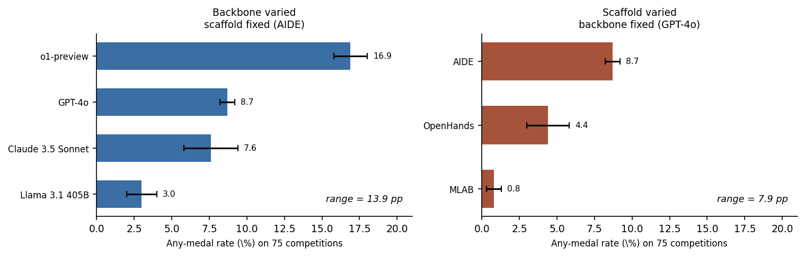

# Agentic AutoML as Program Search
### What Transfers, What Breaks, and What the Field Is Rediscovering

  <b>A reading guide, taxonomy companion, and coded corpus for the Agentic AutoML survey.</b>

  
  
  
  
  
  

---

## 🔎 What this repository is

This repository accompanies the manuscript **“Agentic AutoML as Program Search: What Transfers, What Breaks, and What the Field Is Rediscovering.”** It contains the taxonomy, the coded corpus of systems, the main findings, and the complete bibliography of the survey.

The survey starts from one observation. Agentic AutoML systems built on large language models do not select a configuration from a designer-specified space; they write, execute, and revise programs. The object being optimised is therefore a program, and the space of programs lacks the structure on which classical AutoML results depend. The survey states which classical techniques survive this change, which adapt, and which break, and then tests these predictions against the systems the field has built.

*Figure: the seven-axis taxonomy. The number in each leaf is the count of the 47 coded agentic systems at that position.*

## 🧭 Survey snapshot

| Item | Description |
|---|---|
| **Manuscript title** | Agentic AutoML as Program Search: What Transfers, What Breaks, and What the Field Is Rediscovering |
| **Target venue** | Transactions on Machine Learning Research (TMLR) |
| **Review period** | January 2023 to October 2026 |
| **Coded corpus** | 49 systems: 47 agentic systems and 2 amortised in-context models (TabPFN, TabICL) as a contrasting no-search design point |
| **Corpus by year** | 2023: 1, 2024: 7, 2025: 18, 2026: 21 |
| **Bibliography** | 119 references, listed in full [below](#-complete-bibliography) |
| **Main contribution** | A formal account of agentic AutoML as search over a backbone- and scaffold-dependent reachable set of programs, a transfer analysis of classical AutoML machinery, a seven-axis taxonomy derived from the formalism, and six corpus findings. |

## 🧱 Scope: classical, LLM-assisted, and agentic AutoML

| Setting | What is searched | Who writes the evaluation | Example |
|---|---|---|---|
| **Classical AutoML** | A point in a designer-specified configuration space (CASH, HPO, NAS) | The framework (fixed, external) | [Auto-WEKA: Combined Selection and Hyperparameter Optimization of Classification Algorithms](https://scholar.google.com/scholar?q=Auto-WEKA%3A+Combined+Selection+and+Hyperparameter+Optimization+of+Classification+Algorithms) (2013), [Auto-sklearn 2.0: Hands-free automl via meta-learning](https://scholar.google.com/scholar?q=Auto-sklearn+2.0%3A+Hands-free+automl+via+meta-learning) (2022), [Autogluon-tabular: Robust and accurate automl for structured data](https://arxiv.org/abs/2003.06505) (2020) |
| **LLM-assisted AutoML** | Values or components inside a fixed schema; the language model proposes, a fixed pipeline executes | The framework | [MLCopilot: Unleashing the Power of Large Language Models in Solving Machine Learning Tasks](https://scholar.google.com/scholar?q=MLCopilot%3A+Unleashing+the+Power+of+Large+Language+Models+in+Solving+Machine+Learning+Tasks) (2024), [Large language models for automated data science: Introducing caafe for context-aware automated feature engineering](https://scholar.google.com/scholar?q=Large+language+models+for+automated+data+science%3A+Introducing+caafe+for+context-aware+automated+feature+engineering) (2023) |
| **Agentic AutoML** (this survey) | Executable programs; the agent writes, runs, and revises code in a loop | Often the agent itself | [AIDE: AI-Driven Exploration in the Space of Code](https://arxiv.org/abs/2502.13138) (2025), [MLE-STAR: Machine Learning Engineering Agent via Search and Targeted Refinement](https://scholar.google.com/scholar?q=MLE-STAR%3A+Machine+Learning+Engineering+Agent+via+Search+and+Targeted+Refinement) (2025), [ML-Master: Towards AI-for-AI via Integration of Exploration and Reasoning](https://arxiv.org/abs/2506.16499) (2025) |
| **Amortised in-context models** (contrast only) | Nothing: prediction from context in one forward pass | Not applicable | [Accurate predictions on small data with a tabular foundation model](https://scholar.google.com/scholar?q=Accurate+predictions+on+small+data+with+a+tabular+foundation+model) (2025), [TabICL: A Tabular Foundation Model for In-Context Learning on Large Data](https://scholar.google.com/scholar?q=TabICL%3A+A+Tabular+Foundation+Model+for+In-Context+Learning+on+Large+Data) (2025) |

Agents whose target is open-ended research automation (hypothesis generation, paper writing) are out of scope. A system that describes itself as a research agent is in scope for the results it reports on a machine-learning engineering benchmark with a measurable objective.

## 📐 Six structural properties and what transfers

Classical AutoML methods rely on six properties of the configuration space. Program search forfeits four of them. The transfer analysis follows from which properties each technique needs.

| Classical technique | Status under program search | Reason |
|---|---|---|
| GP surrogate + acquisition | **Breaks** | Needs a metric on the search space; no faithful kernel exists on programs, and candidates cannot be enumerated cheaply. |
| Tree-structured surrogates (SMAC, TPE) | **Breaks** | Needs a fixed, typed configuration schema. |
| Successive halving / Hyperband | **Adapts, with loss of guarantee** | Fidelity is available, but the agent controls its own evaluation code, and proposals are not free. |
| Evolutionary / population search | **Survives** | Needs only mutation and selection; mutation becomes LLM-conditioned rewriting. |
| Monte-Carlo tree search | **Survives** | Needs only a tree of states and a value estimate. |
| Meta-learning / warm-starting | **Transformed** | Pretraining of the backbone is an implicit, uncontrolled warm-start, which is also the source of contamination. |
| Multi-objective / Pareto search | **Survives** | Independent of search-space structure. |
| Regret analysis | **Breaks** | No compact domain, no known kernel, and an endogenous, possibly non-stationary objective. |

## 🧩 Seven-axis taxonomy

Axes A–C instantiate the components of the agent scaffold. Axes D–G correspond to structural properties of the classical configuration space that program search loses and must therefore handle explicitly.

| Axis | Question | Positions |
|---|---|---|
| **A. Action-space granularity** | What does one step of the system emit? | A1 whole-program rewrite · A2 component-level rewrite · A3 hyperparameter proposal · A4 tool / library invocation |
| **B. Search operator σ** | Which rule selects the next node to expand? | B1 single-pass · B2 greedy · B3 tree / graph search · B4 population · B5 ablation-guided · B6 role-decomposed · B7 learned policy; plus the cross-cutting *recombination* sub-property |
| **C. Memory and context U** | How do execution observations re-enter the context? | C1 flat history · C2 structured trace / tree · C3 retrieval / case-based · C4 persistent skill library |
| **D. Verification regime V** | Which violations are checked, and are they prevented or only detected? | syntactic only · detective (post hoc) · structural (violation inexpressible) · semantic (unbiased score) |
| **E. Cost model** | Are generation cost and execution cost modelled or reported? | E1 unreported · E2ₓ execution cost · E2_g generation cost · E3 both (generation fraction φ computable) |
| **F. Classical hybridisation** | How much classical AutoML machinery is reused? | F1 none · F2 warm-start / prior shaping · F3 full delegation to an AutoML library |
| **G. Objective stationarity** | Is the data and objective assumed fixed? | G1 static · G2 drifting / temporal · G3 federated / partially observable |

## 🛠️ Detailed guide by axis

### A. Action-space granularity

| Position | Count | Systems |
|---|---|---|
| **A1** Whole-program rewrite | 31 | [AIDE](https://arxiv.org/abs/2502.13138), [ML-Master](https://arxiv.org/abs/2506.16499), [R&D-Agent](https://arxiv.org/abs/2505.14738), [AutoMind](https://arxiv.org/abs/2506.10974), [AutoML-Agent](https://arxiv.org/abs/2410.02958), [DS-Agent](https://arxiv.org/abs/2402.17453), [Data-Interpreter](https://arxiv.org/abs/2402.18679), [MetaGPT](https://arxiv.org/abs/2308.00352), [AutoKaggle](https://arxiv.org/abs/2410.20424), [FM-Agent](https://arxiv.org/abs/2510.26144), [KompeteAI](https://arxiv.org/abs/2508.10177), [ArchPilot](https://arxiv.org/abs/2511.03985), [Operand-Quant](https://arxiv.org/abs/2510.11694), [ML-Agent](https://arxiv.org/abs/2505.23723), [RL4MLE](https://arxiv.org/abs/2509.01684), [AgentGA](https://arxiv.org/abs/2604.14655), [GEAR](https://arxiv.org/abs/2605.13874), [MARS](https://arxiv.org/abs/2602.02660), [CoMind](https://arxiv.org/abs/2506.20640), [Agent-K](https://arxiv.org/abs/2411.03562), [EurekAgent](https://arxiv.org/abs/2606.13662), [KAPSO](https://arxiv.org/abs/2601.21526), [HASTE](https://arxiv.org/abs/2606.30911), [SEA-TS](https://arxiv.org/abs/2603.04873), [AIRA-dojo](https://arxiv.org/abs/2507.02554), [MLE-Ideator](https://aclanthology.org/2026.eacl-short.32.pdf), [SandMLE](https://arxiv.org/abs/2604.04872), [AiScientist](https://arxiv.org/abs/2604.13018), [ScienceFlow](https://arxiv.org/abs/2608.14354), [Praxist](https://arxiv.org/abs/2608.25955), [Malena](https://arxiv.org/abs/2609.40303) |
| **A2** Component-level rewrite | 11 | [MLE-STAR](https://arxiv.org/abs/2506.15692), [I-MCTS](https://arxiv.org/abs/2502.14693), [SELA](https://arxiv.org/abs/2410.17238), [CAAFE](https://scholar.google.com/scholar?q=Large+language+models+for+automated+data+science%3A+Introducing+caafe+for+context-aware+automated+feature+engineering), [AutoMLGen](https://arxiv.org/abs/2510.08511), [MLEvolve](https://arxiv.org/abs/2606.06473), [MALMAS](https://arxiv.org/abs/2604.20261), [LLM-FE](https://arxiv.org/abs/2503.14434), [iML](https://arxiv.org/abs/2602.13937), [Arbor](https://arxiv.org/abs/2606.11926), [AgentNAS](https://arxiv.org/abs/2607.07984) |
| **A3** Hyperparameter proposal | 2 | [GizaML](https://scholar.google.com/scholar?q=GizaML%3A+A+Collaborative+Meta-learning+Based+Framework+Using+LLM+For+Automated+Time-Series+Forecasting.), [MLCopilot](https://scholar.google.com/scholar?q=MLCopilot%3A+Unleashing+the+Power+of+Large+Language+Models+in+Solving+Machine+Learning+Tasks) |
| **A4** Tool / library invocation | 3 | [LightAutoDS-Tab](https://arxiv.org/abs/2507.13413), [MLZero](https://arxiv.org/abs/2505.13941), [BDaaS-Agent](https://arxiv.org/abs/2606.17915) |

### B. Search operator σ

| Position | Count | Systems |
|---|---|---|
| **B1** Single-pass / plan-then-execute | 5 | [Data-Interpreter](https://arxiv.org/abs/2402.18679), [GizaML](https://scholar.google.com/scholar?q=GizaML%3A+A+Collaborative+Meta-learning+Based+Framework+Using+LLM+For+Automated+Time-Series+Forecasting.), [LightAutoDS-Tab](https://arxiv.org/abs/2507.13413), [MLCopilot](https://scholar.google.com/scholar?q=MLCopilot%3A+Unleashing+the+Power+of+Large+Language+Models+in+Solving+Machine+Learning+Tasks), [Agent-K](https://arxiv.org/abs/2411.03562) |
| **B2** Greedy refinement | 6 | [AIDE](https://arxiv.org/abs/2502.13138), [DS-Agent](https://arxiv.org/abs/2402.17453), [CAAFE](https://scholar.google.com/scholar?q=Large+language+models+for+automated+data+science%3A+Introducing+caafe+for+context-aware+automated+feature+engineering), [Operand-Quant](https://arxiv.org/abs/2510.11694), [KAPSO](https://arxiv.org/abs/2601.21526), [Malena](https://arxiv.org/abs/2609.40303) |
| **B3** Tree or graph search | 12 | [ML-Master](https://arxiv.org/abs/2506.16499), [AutoMind](https://arxiv.org/abs/2506.10974), [I-MCTS](https://arxiv.org/abs/2502.14693), [SELA](https://arxiv.org/abs/2410.17238), [AutoMLGen](https://arxiv.org/abs/2510.08511), [KompeteAI](https://arxiv.org/abs/2508.10177), [ArchPilot](https://arxiv.org/abs/2511.03985), [MARS](https://arxiv.org/abs/2602.02660), [SEA-TS](https://arxiv.org/abs/2603.04873), [AIRA-dojo](https://arxiv.org/abs/2507.02554), [Arbor](https://arxiv.org/abs/2606.11926), [ScienceFlow](https://arxiv.org/abs/2608.14354) |
| **B4** Population / evolutionary | 8 | [FM-Agent](https://arxiv.org/abs/2510.26144), [AgentGA](https://arxiv.org/abs/2604.14655), [GEAR](https://arxiv.org/abs/2605.13874), [MLEvolve](https://arxiv.org/abs/2606.06473), [CoMind](https://arxiv.org/abs/2506.20640), [LLM-FE](https://arxiv.org/abs/2503.14434), [Praxist](https://arxiv.org/abs/2608.25955), [AgentNAS](https://arxiv.org/abs/2607.07984) |
| **B5** Ablation-guided targeting | 1 | [MLE-STAR](https://arxiv.org/abs/2506.15692) |
| **B6** Role-decomposed | 11 | [R&D-Agent](https://arxiv.org/abs/2505.14738), [AutoML-Agent](https://arxiv.org/abs/2410.02958), [MetaGPT](https://arxiv.org/abs/2308.00352), [AutoKaggle](https://arxiv.org/abs/2410.20424), [MLZero](https://arxiv.org/abs/2505.13941), [BDaaS-Agent](https://arxiv.org/abs/2606.17915), [MALMAS](https://arxiv.org/abs/2604.20261), [EurekAgent](https://arxiv.org/abs/2606.13662), [HASTE](https://arxiv.org/abs/2606.30911), [iML](https://arxiv.org/abs/2602.13937), [AiScientist](https://arxiv.org/abs/2604.13018) |
| **B7** Learned (RL-trained) policy | 4 | [ML-Agent](https://arxiv.org/abs/2505.23723), [RL4MLE](https://arxiv.org/abs/2509.01684), [MLE-Ideator](https://aclanthology.org/2026.eacl-short.32.pdf), [SandMLE](https://arxiv.org/abs/2604.04872) |
| *Recombination present* (cross-cutting) | 14 | [MLE-STAR](https://arxiv.org/abs/2506.15692), [I-MCTS](https://arxiv.org/abs/2502.14693), [FM-Agent](https://arxiv.org/abs/2510.26144), [AutoMLGen](https://arxiv.org/abs/2510.08511), [KompeteAI](https://arxiv.org/abs/2508.10177), [AgentGA](https://arxiv.org/abs/2604.14655), [GEAR](https://arxiv.org/abs/2605.13874), [MLEvolve](https://arxiv.org/abs/2606.06473), [MARS](https://arxiv.org/abs/2602.02660), [LLM-FE](https://arxiv.org/abs/2503.14434), [SEA-TS](https://arxiv.org/abs/2603.04873), [AiScientist](https://arxiv.org/abs/2604.13018), [Praxist](https://arxiv.org/abs/2608.25955), [AgentNAS](https://arxiv.org/abs/2607.07984) |
| *Cheap-fidelity evaluation* (cross-cutting) | 3 | [ArchPilot](https://arxiv.org/abs/2511.03985), [Praxist](https://arxiv.org/abs/2608.25955), [AgentNAS](https://arxiv.org/abs/2607.07984) |

### C. Memory and context construction

| Position | Count | Systems |
|---|---|---|
| **C1** Flat truncated history | 15 | [R&D-Agent](https://arxiv.org/abs/2505.14738), [MetaGPT](https://arxiv.org/abs/2308.00352), [AutoKaggle](https://arxiv.org/abs/2410.20424), [CAAFE](https://scholar.google.com/scholar?q=Large+language+models+for+automated+data+science%3A+Introducing+caafe+for+context-aware+automated+feature+engineering), [LightAutoDS-Tab](https://arxiv.org/abs/2507.13413), [Operand-Quant](https://arxiv.org/abs/2510.11694), [ML-Agent](https://arxiv.org/abs/2505.23723), [RL4MLE](https://arxiv.org/abs/2509.01684), [BDaaS-Agent](https://arxiv.org/abs/2606.17915), [EurekAgent](https://arxiv.org/abs/2606.13662), [iML](https://arxiv.org/abs/2602.13937), [MLE-Ideator](https://aclanthology.org/2026.eacl-short.32.pdf), [SandMLE](https://arxiv.org/abs/2604.04872), [Malena](https://arxiv.org/abs/2609.40303), [AgentNAS](https://arxiv.org/abs/2607.07984) |
| **C2** Structured trace / tree state | 15 | [AIDE](https://arxiv.org/abs/2502.13138), [ML-Master](https://arxiv.org/abs/2506.16499), [I-MCTS](https://arxiv.org/abs/2502.14693), [Data-Interpreter](https://arxiv.org/abs/2402.18679), [SELA](https://arxiv.org/abs/2410.17238), [ArchPilot](https://arxiv.org/abs/2511.03985), [AgentGA](https://arxiv.org/abs/2604.14655), [GEAR](https://arxiv.org/abs/2605.13874), [MARS](https://arxiv.org/abs/2602.02660), [SEA-TS](https://arxiv.org/abs/2603.04873), [AIRA-dojo](https://arxiv.org/abs/2507.02554), [AiScientist](https://arxiv.org/abs/2604.13018), [Arbor](https://arxiv.org/abs/2606.11926), [ScienceFlow](https://arxiv.org/abs/2608.14354), [Praxist](https://arxiv.org/abs/2608.25955) |
| **C3** Retrieval / case-based | 12 | [MLE-STAR](https://arxiv.org/abs/2506.15692), [AutoMind](https://arxiv.org/abs/2506.10974), [AutoML-Agent](https://arxiv.org/abs/2410.02958), [DS-Agent](https://arxiv.org/abs/2402.17453), [GizaML](https://scholar.google.com/scholar?q=GizaML%3A+A+Collaborative+Meta-learning+Based+Framework+Using+LLM+For+Automated+Time-Series+Forecasting.), [MLZero](https://arxiv.org/abs/2505.13941), [FM-Agent](https://arxiv.org/abs/2510.26144), [AutoMLGen](https://arxiv.org/abs/2510.08511), [KompeteAI](https://arxiv.org/abs/2508.10177), [MLCopilot](https://scholar.google.com/scholar?q=MLCopilot%3A+Unleashing+the+Power+of+Large+Language+Models+in+Solving+Machine+Learning+Tasks), [CoMind](https://arxiv.org/abs/2506.20640), [KAPSO](https://arxiv.org/abs/2601.21526) |
| **C4** Persistent skill library | 5 | [MLEvolve](https://arxiv.org/abs/2606.06473), [MALMAS](https://arxiv.org/abs/2604.20261), [LLM-FE](https://arxiv.org/abs/2503.14434), [Agent-K](https://arxiv.org/abs/2411.03562), [HASTE](https://arxiv.org/abs/2606.30911) |

### D. Verification regime

| Position | Count | Systems |
|---|---|---|
| **Syntactic only** | 30 | [AIDE](https://arxiv.org/abs/2502.13138), [MLE-STAR](https://arxiv.org/abs/2506.15692), [ML-Master](https://arxiv.org/abs/2506.16499), [R&D-Agent](https://arxiv.org/abs/2505.14738), [AutoMind](https://arxiv.org/abs/2506.10974), [I-MCTS](https://arxiv.org/abs/2502.14693), [DS-Agent](https://arxiv.org/abs/2402.17453), [MetaGPT](https://arxiv.org/abs/2308.00352), [SELA](https://arxiv.org/abs/2410.17238), [AutoMLGen](https://arxiv.org/abs/2510.08511), [KompeteAI](https://arxiv.org/abs/2508.10177), [ArchPilot](https://arxiv.org/abs/2511.03985), [Operand-Quant](https://arxiv.org/abs/2510.11694), [ML-Agent](https://arxiv.org/abs/2505.23723), [RL4MLE](https://arxiv.org/abs/2509.01684), [AgentGA](https://arxiv.org/abs/2604.14655), [GEAR](https://arxiv.org/abs/2605.13874), [MLEvolve](https://arxiv.org/abs/2606.06473), [MARS](https://arxiv.org/abs/2602.02660), [CoMind](https://arxiv.org/abs/2506.20640), [MALMAS](https://arxiv.org/abs/2604.20261), [KAPSO](https://arxiv.org/abs/2601.21526), [HASTE](https://arxiv.org/abs/2606.30911), [AIRA-dojo](https://arxiv.org/abs/2507.02554), [MLE-Ideator](https://aclanthology.org/2026.eacl-short.32.pdf), [SandMLE](https://arxiv.org/abs/2604.04872), [AiScientist](https://arxiv.org/abs/2604.13018), [ScienceFlow](https://arxiv.org/abs/2608.14354), [Malena](https://arxiv.org/abs/2609.40303), [AgentNAS](https://arxiv.org/abs/2607.07984) |
| **Detective** (violations detected after the fact) | 10 | [AutoML-Agent](https://arxiv.org/abs/2410.02958), [Data-Interpreter](https://arxiv.org/abs/2402.18679), [AutoKaggle](https://arxiv.org/abs/2410.20424), [CAAFE](https://scholar.google.com/scholar?q=Large+language+models+for+automated+data+science%3A+Introducing+caafe+for+context-aware+automated+feature+engineering), [FM-Agent](https://arxiv.org/abs/2510.26144), [BDaaS-Agent](https://arxiv.org/abs/2606.17915), [LLM-FE](https://arxiv.org/abs/2503.14434), [Agent-K](https://arxiv.org/abs/2411.03562), [SEA-TS](https://arxiv.org/abs/2603.04873), [iML](https://arxiv.org/abs/2602.13937) |
| **Structural** (violations inexpressible) | 7 | [GizaML](https://scholar.google.com/scholar?q=GizaML%3A+A+Collaborative+Meta-learning+Based+Framework+Using+LLM+For+Automated+Time-Series+Forecasting.), [LightAutoDS-Tab](https://arxiv.org/abs/2507.13413), [MLZero](https://arxiv.org/abs/2505.13941), [MLCopilot](https://scholar.google.com/scholar?q=MLCopilot%3A+Unleashing+the+Power+of+Large+Language+Models+in+Solving+Machine+Learning+Tasks), [EurekAgent](https://arxiv.org/abs/2606.13662), [Arbor](https://arxiv.org/abs/2606.11926), [Praxist](https://arxiv.org/abs/2608.25955) |
| **Semantic** (score checked for unbiasedness) | 0 | — |

### E. Cost model

| Position | Count | Systems |
|---|---|---|
| **E1** Unreported | 37 | [AIDE](https://arxiv.org/abs/2502.13138), [MLE-STAR](https://arxiv.org/abs/2506.15692), [ML-Master](https://arxiv.org/abs/2506.16499), [R&D-Agent](https://arxiv.org/abs/2505.14738), [AutoMind](https://arxiv.org/abs/2506.10974), [I-MCTS](https://arxiv.org/abs/2502.14693), [AutoML-Agent](https://arxiv.org/abs/2410.02958), [DS-Agent](https://arxiv.org/abs/2402.17453), [Data-Interpreter](https://arxiv.org/abs/2402.18679), [MetaGPT](https://arxiv.org/abs/2308.00352), [AutoKaggle](https://arxiv.org/abs/2410.20424), [SELA](https://arxiv.org/abs/2410.17238), [CAAFE](https://scholar.google.com/scholar?q=Large+language+models+for+automated+data+science%3A+Introducing+caafe+for+context-aware+automated+feature+engineering), [GizaML](https://scholar.google.com/scholar?q=GizaML%3A+A+Collaborative+Meta-learning+Based+Framework+Using+LLM+For+Automated+Time-Series+Forecasting.), [LightAutoDS-Tab](https://arxiv.org/abs/2507.13413), [MLZero](https://arxiv.org/abs/2505.13941), [FM-Agent](https://arxiv.org/abs/2510.26144), [AutoMLGen](https://arxiv.org/abs/2510.08511), [KompeteAI](https://arxiv.org/abs/2508.10177), [ArchPilot](https://arxiv.org/abs/2511.03985), [Operand-Quant](https://arxiv.org/abs/2510.11694), [MLCopilot](https://scholar.google.com/scholar?q=MLCopilot%3A+Unleashing+the+Power+of+Large+Language+Models+in+Solving+Machine+Learning+Tasks), [ML-Agent](https://arxiv.org/abs/2505.23723), [AgentGA](https://arxiv.org/abs/2604.14655), [GEAR](https://arxiv.org/abs/2605.13874), [MLEvolve](https://arxiv.org/abs/2606.06473), [BDaaS-Agent](https://arxiv.org/abs/2606.17915), [CoMind](https://arxiv.org/abs/2506.20640), [MALMAS](https://arxiv.org/abs/2604.20261), [LLM-FE](https://arxiv.org/abs/2503.14434), [Agent-K](https://arxiv.org/abs/2411.03562), [KAPSO](https://arxiv.org/abs/2601.21526), [HASTE](https://arxiv.org/abs/2606.30911), [SEA-TS](https://arxiv.org/abs/2603.04873), [iML](https://arxiv.org/abs/2602.13937), [AIRA-dojo](https://arxiv.org/abs/2507.02554), [SandMLE](https://arxiv.org/abs/2604.04872) |
| **E2ₓ** Execution cost modelled or reported | 5 | [RL4MLE](https://arxiv.org/abs/2509.01684), [MARS](https://arxiv.org/abs/2602.02660), [EurekAgent](https://arxiv.org/abs/2606.13662), [ScienceFlow](https://arxiv.org/abs/2608.14354), [AgentNAS](https://arxiv.org/abs/2607.07984) |
| **E2_g** Generation cost reported | 5 | [MLE-Ideator](https://aclanthology.org/2026.eacl-short.32.pdf), [AiScientist](https://arxiv.org/abs/2604.13018), [Arbor](https://arxiv.org/abs/2606.11926), [Praxist](https://arxiv.org/abs/2608.25955), [Malena](https://arxiv.org/abs/2609.40303) |
| **E3** Both reported | 0 | — |

### F. Hybridisation with classical AutoML

| Position | Count | Systems |
|---|---|---|
| **F1** None | 38 | [AIDE](https://arxiv.org/abs/2502.13138), [MLE-STAR](https://arxiv.org/abs/2506.15692), [ML-Master](https://arxiv.org/abs/2506.16499), [R&D-Agent](https://arxiv.org/abs/2505.14738), [AutoMind](https://arxiv.org/abs/2506.10974), [I-MCTS](https://arxiv.org/abs/2502.14693), [AutoML-Agent](https://arxiv.org/abs/2410.02958), [DS-Agent](https://arxiv.org/abs/2402.17453), [Data-Interpreter](https://arxiv.org/abs/2402.18679), [MetaGPT](https://arxiv.org/abs/2308.00352), [AutoKaggle](https://arxiv.org/abs/2410.20424), [FM-Agent](https://arxiv.org/abs/2510.26144), [AutoMLGen](https://arxiv.org/abs/2510.08511), [KompeteAI](https://arxiv.org/abs/2508.10177), [ArchPilot](https://arxiv.org/abs/2511.03985), [Operand-Quant](https://arxiv.org/abs/2510.11694), [ML-Agent](https://arxiv.org/abs/2505.23723), [RL4MLE](https://arxiv.org/abs/2509.01684), [AgentGA](https://arxiv.org/abs/2604.14655), [GEAR](https://arxiv.org/abs/2605.13874), [MLEvolve](https://arxiv.org/abs/2606.06473), [MARS](https://arxiv.org/abs/2602.02660), [CoMind](https://arxiv.org/abs/2506.20640), [MALMAS](https://arxiv.org/abs/2604.20261), [LLM-FE](https://arxiv.org/abs/2503.14434), [EurekAgent](https://arxiv.org/abs/2606.13662), [KAPSO](https://arxiv.org/abs/2601.21526), [HASTE](https://arxiv.org/abs/2606.30911), [SEA-TS](https://arxiv.org/abs/2603.04873), [iML](https://arxiv.org/abs/2602.13937), [AIRA-dojo](https://arxiv.org/abs/2507.02554), [MLE-Ideator](https://aclanthology.org/2026.eacl-short.32.pdf), [SandMLE](https://arxiv.org/abs/2604.04872), [AiScientist](https://arxiv.org/abs/2604.13018), [Arbor](https://arxiv.org/abs/2606.11926), [ScienceFlow](https://arxiv.org/abs/2608.14354), [Praxist](https://arxiv.org/abs/2608.25955), [Malena](https://arxiv.org/abs/2609.40303) |
| **F2** Warm-start / prior shaping | 6 | [SELA](https://arxiv.org/abs/2410.17238), [CAAFE](https://scholar.google.com/scholar?q=Large+language+models+for+automated+data+science%3A+Introducing+caafe+for+context-aware+automated+feature+engineering), [GizaML](https://scholar.google.com/scholar?q=GizaML%3A+A+Collaborative+Meta-learning+Based+Framework+Using+LLM+For+Automated+Time-Series+Forecasting.), [MLCopilot](https://scholar.google.com/scholar?q=MLCopilot%3A+Unleashing+the+Power+of+Large+Language+Models+in+Solving+Machine+Learning+Tasks), [Agent-K](https://arxiv.org/abs/2411.03562), [AgentNAS](https://arxiv.org/abs/2607.07984) |
| **F3** Full delegation to an AutoML library | 3 | [LightAutoDS-Tab](https://arxiv.org/abs/2507.13413), [MLZero](https://arxiv.org/abs/2505.13941), [BDaaS-Agent](https://arxiv.org/abs/2606.17915) |

### G. Objective stationarity

| Position | Count | Systems |
|---|---|---|
| **G1** Static | 44 | [AIDE](https://arxiv.org/abs/2502.13138), [MLE-STAR](https://arxiv.org/abs/2506.15692), [ML-Master](https://arxiv.org/abs/2506.16499), [R&D-Agent](https://arxiv.org/abs/2505.14738), [AutoMind](https://arxiv.org/abs/2506.10974), [I-MCTS](https://arxiv.org/abs/2502.14693), [AutoML-Agent](https://arxiv.org/abs/2410.02958), [DS-Agent](https://arxiv.org/abs/2402.17453), [Data-Interpreter](https://arxiv.org/abs/2402.18679), [MetaGPT](https://arxiv.org/abs/2308.00352), [AutoKaggle](https://arxiv.org/abs/2410.20424), [SELA](https://arxiv.org/abs/2410.17238), [CAAFE](https://scholar.google.com/scholar?q=Large+language+models+for+automated+data+science%3A+Introducing+caafe+for+context-aware+automated+feature+engineering), [LightAutoDS-Tab](https://arxiv.org/abs/2507.13413), [MLZero](https://arxiv.org/abs/2505.13941), [FM-Agent](https://arxiv.org/abs/2510.26144), [AutoMLGen](https://arxiv.org/abs/2510.08511), [KompeteAI](https://arxiv.org/abs/2508.10177), [ArchPilot](https://arxiv.org/abs/2511.03985), [Operand-Quant](https://arxiv.org/abs/2510.11694), [MLCopilot](https://scholar.google.com/scholar?q=MLCopilot%3A+Unleashing+the+Power+of+Large+Language+Models+in+Solving+Machine+Learning+Tasks), [ML-Agent](https://arxiv.org/abs/2505.23723), [RL4MLE](https://arxiv.org/abs/2509.01684), [AgentGA](https://arxiv.org/abs/2604.14655), [GEAR](https://arxiv.org/abs/2605.13874), [MLEvolve](https://arxiv.org/abs/2606.06473), [MARS](https://arxiv.org/abs/2602.02660), [CoMind](https://arxiv.org/abs/2506.20640), [MALMAS](https://arxiv.org/abs/2604.20261), [LLM-FE](https://arxiv.org/abs/2503.14434), [Agent-K](https://arxiv.org/abs/2411.03562), [EurekAgent](https://arxiv.org/abs/2606.13662), [KAPSO](https://arxiv.org/abs/2601.21526), [HASTE](https://arxiv.org/abs/2606.30911), [iML](https://arxiv.org/abs/2602.13937), [AIRA-dojo](https://arxiv.org/abs/2507.02554), [MLE-Ideator](https://aclanthology.org/2026.eacl-short.32.pdf), [SandMLE](https://arxiv.org/abs/2604.04872), [AiScientist](https://arxiv.org/abs/2604.13018), [Arbor](https://arxiv.org/abs/2606.11926), [ScienceFlow](https://arxiv.org/abs/2608.14354), [Praxist](https://arxiv.org/abs/2608.25955), [Malena](https://arxiv.org/abs/2609.40303), [AgentNAS](https://arxiv.org/abs/2607.07984) |
| **G2** Drifting / temporal | 3 | [GizaML](https://scholar.google.com/scholar?q=GizaML%3A+A+Collaborative+Meta-learning+Based+Framework+Using+LLM+For+Automated+Time-Series+Forecasting.), [BDaaS-Agent](https://arxiv.org/abs/2606.17915), [SEA-TS](https://arxiv.org/abs/2603.04873) |
| **G3** Federated / partially observable | 0 | — |

## 🧾 Coded corpus

All 49 systems with their position on every axis, as in Table 4 of the paper. Rows in *italics* are the amortised models included only for contrast. **Rec.** = recombination; **Fid.** = cheap-fidelity evaluation; **Conf.** = coding confidence (●●● primary source, ●●○ secondary description).

| System | Year | Status | A | B | Rec. | Fid. | C | D | E | F | G | Conf. |
|---|---|---|---|---|---|---|---|---|---|---|---|---|
| **[CAAFE](https://scholar.google.com/scholar?q=Large+language+models+for+automated+data+science%3A+Introducing+caafe+for+context-aware+automated+feature+engineering)** | 2023 | Advances in Neural Information Processing Systems | A2 | B2 |  |  | C1 | V_prot (detective) | E1 | F2 | G1 | ●●● |
| **[Agent-K](https://arxiv.org/abs/2411.03562)** | 2024 | arXiv preprint | A1 | B1 |  |  | C4 | V_prot (detective) | E1 | F2 | G1 | ●●● |
| **[AutoKaggle](https://arxiv.org/abs/2410.20424)** | 2024 | arXiv preprint | A1 | B6 |  |  | C1 | V_prot (detective) | E1 | F1 | G1 | ●●● |
| **[DS-Agent](https://arxiv.org/abs/2402.17453)** | 2024 | Proceedings of the International Conference on Machine Learning (ICML) | A1 | B2 |  |  | C3 | V_syn | E1 | F1 | G1 | ●●● |
| **[GizaML](https://scholar.google.com/scholar?q=GizaML%3A+A+Collaborative+Meta-learning+Based+Framework+Using+LLM+For+Automated+Time-Series+Forecasting.)** | 2024 | EDBT | A3 | B1 |  |  | C3 | V_prot (structural) | E1 | F2 | G2 | ●●● |
| **[MetaGPT](https://arxiv.org/abs/2308.00352)** | 2024 | Proceedings of the International Conference on Learning Representations (ICLR) | A1 | B6 |  |  | C1 | V_syn | E1 | F1 | G1 | ●●● |
| **[MLCopilot](https://scholar.google.com/scholar?q=MLCopilot%3A+Unleashing+the+Power+of+Large+Language+Models+in+Solving+Machine+Learning+Tasks)** | 2024 | Proceedings of the 18th Conference of the European Chapter of the Association for Computational Linguistics (EACL) | A3 | B1 |  |  | C3 | V_prot (structural) | E1 | F2 | G1 | ●●● |
| **[SELA](https://arxiv.org/abs/2410.17238)** | 2024 | arXiv preprint | A2 | B3 |  |  | C2 | V_syn | E1 | F2 | G1 | ●●● |
| **[AIDE](https://arxiv.org/abs/2502.13138)** | 2025 | arXiv preprint | A1 | B2 |  |  | C2 | V_syn | E1 | F1 | G1 | ●●● |
| **[AIRA-dojo](https://arxiv.org/abs/2507.02554)** | 2025 | arXiv preprint | A1 | B3 |  |  | C2 | V_syn | E1 | F1 | G1 | ●●● |
| **[ArchPilot](https://arxiv.org/abs/2511.03985)** | 2025 | arXiv preprint | A1 | B3 |  | ✓ | C2 | V_syn | E1 | F1 | G1 | ●●● |
| **[AutoMind](https://arxiv.org/abs/2506.10974)** | 2025 | arXiv preprint | A1 | B3 |  |  | C3 | V_syn | E1 | F1 | G1 | ●●● |
| **[AutoML-Agent](https://arxiv.org/abs/2410.02958)** | 2025 | Proceedings of the International Conference on Machine Learning (ICML) | A1 | B6 |  |  | C3 | V_prot (detective) | E1 | F1 | G1 | ●●● |
| **[AutoMLGen](https://arxiv.org/abs/2510.08511)** | 2025 | arXiv preprint | A2 | B3ᵍ | ✓ |  | C3 | V_syn | E1 | F1 | G1 | ●●● |
| **[CoMind](https://arxiv.org/abs/2506.20640)** | 2025 | International Conference on Learning Representations | A1 | B4 |  |  | C3 | V_syn | E1 | F1 | G1 | ●●● |
| **[Data-Interpreter](https://arxiv.org/abs/2402.18679)** | 2025 | Findings of the Association for Computational Linguistics: ACL 2025 | A1 | B1 |  |  | C2 | V_prot (detective) | E1 | F1 | G1 | ●●○ |
| **[FM-Agent](https://arxiv.org/abs/2510.26144)** | 2025 | arXiv preprint | A1 | B4 | ✓ |  | C3 | V_prot (detective) | E1 | F1 | G1 | ●●● |
| **[KompeteAI](https://arxiv.org/abs/2508.10177)** | 2025 | arXiv preprint | A1 | B3 | ✓ |  | C3 | V_syn | E1 | F1 | G1 | ●●● |
| **[LightAutoDS-Tab](https://arxiv.org/abs/2507.13413)** | 2025 | arXiv preprint | A4 | B1 |  |  | C1 | V_prot (structural) | E1 | F3 | G1 | ●●● |
| **[ML-Agent](https://arxiv.org/abs/2505.23723)** | 2025 | International Conference on Machine Learning | A1 | B7 |  |  | C1 | V_syn | E1 | F1 | G1 | ●●● |
| **[ML-Master](https://arxiv.org/abs/2506.16499)** | 2025 | arXiv preprint | A1 | B3 |  |  | C2 | V_syn | E1 | F1 | G1 | ●●● |
| **[MLE-STAR](https://arxiv.org/abs/2506.15692)** | 2025 | Advances in Neural Information Processing Systems | A2 | B5 | ✓ |  | C3 | V_syn | E1 | F1 | G1 | ●●● |
| **[MLZero](https://arxiv.org/abs/2505.13941)** | 2025 | Advances in Neural Information Processing Systems (NeurIPS) | A4 | B6 |  |  | C3 | V_prot (structural) | E1 | F3 | G1 | ●●● |
| **[Operand-Quant](https://arxiv.org/abs/2510.11694)** | 2025 | arXiv preprint | A1 | B2 |  |  | C1 | V_syn | E1 | F1 | G1 | ●●○ |
| **[R&D-Agent](https://arxiv.org/abs/2505.14738)** | 2025 | arXiv preprint | A1 | B6 |  |  | C1 | V_syn | E1 | F1 | G1 | ●●● |
| **[RL4MLE](https://arxiv.org/abs/2509.01684)** | 2025 | International Conference on Learning Representations | A1 | B7 |  |  | C1 | V_syn | E2ₓ | F1 | G1 | ●●● |
| **[AgentGA](https://arxiv.org/abs/2604.14655)** | 2026 | arXiv preprint | A1 | B4 | ✓ |  | C2 | V_syn | E1 | F1 | G1 | ●●○ |
| **[AgentNAS](https://arxiv.org/abs/2607.07984)** | 2026 | arXiv preprint | A2 | B4 | ✓ | ✓ | C1 | V_syn | E2ₓ | F2 | G1 | ●●● |
| **[AiScientist](https://arxiv.org/abs/2604.13018)** | 2026 | arXiv preprint | A1 | B6 | ✓ |  | C2 | V_syn | E2_g | F1 | G1 | ●●○ |
| **[Arbor](https://arxiv.org/abs/2606.11926)** | 2026 | arXiv preprint | A2 | B3 |  |  | C2 | V_prot (structural) | E2_g | F1 | G1 | ●●● |
| **[BDaaS-Agent](https://arxiv.org/abs/2606.17915)** | 2026 | arXiv preprint | A4 | B6 |  |  | C1 | V_prot (detective) | E1 | F3 | G2 | ●●○ |
| **[EurekAgent](https://arxiv.org/abs/2606.13662)** | 2026 | arXiv preprint | A1 | B6 |  |  | C1 | V_prot (structural) | E2ₓ | F1 | G1 | ●●● |
| **[GEAR](https://arxiv.org/abs/2605.13874)** | 2026 | arXiv preprint | A1 | B4 | ✓ |  | C2 | V_syn | E1 | F1 | G1 | ●●○ |
| **[HASTE](https://arxiv.org/abs/2606.30911)** | 2026 | arXiv preprint | A1 | B6 |  |  | C4 | V_syn | E1 | F1 | G1 | ●●● |
| **[I-MCTS](https://arxiv.org/abs/2502.14693)** | 2026 | Findings of the Association for Computational Linguistics: EACL | A2 | B3 | ✓ |  | C2 | V_syn | E1 | F1 | G1 | ●●● |
| **[iML](https://arxiv.org/abs/2602.13937)** | 2026 | arXiv preprint | A2 | B6 |  |  | C1 | V_prot (detective) | E1 | F1 | G1 | ●●● |
| **[KAPSO](https://arxiv.org/abs/2601.21526)** | 2026 | arXiv preprint | A1 | B2 |  |  | C3 | V_syn | E1 | F1 | G1 | ●●● |
| **[LLM-FE](https://arxiv.org/abs/2503.14434)** | 2026 | Transactions on Machine Learning Research | A2 | B4 | ✓ |  | C4 | V_prot (detective) | E1 | F1 | G1 | ●●● |
| **[Malena](https://arxiv.org/abs/2609.40303)** | 2026 | arXiv preprint | A1 | B2 |  |  | C1 | V_syn | E2_g | F1 | G1 | ●●● |
| **[MALMAS](https://arxiv.org/abs/2604.20261)** | 2026 | Proceedings of the 64th Annual Meeting of the Association for Computational Linguistics (ACL) | A2 | B6 |  |  | C4 | V_syn | E1 | F1 | G1 | ●●● |
| **[MARS](https://arxiv.org/abs/2602.02660)** | 2026 | arXiv preprint | A1 | B3 | ✓ |  | C2 | V_syn | E2ₓ | F1 | G1 | ●●● |
| **[MLE-Ideator](https://aclanthology.org/2026.eacl-short.32.pdf)** | 2026 | Proceedings of the 19th Conference of the European Chapter of the Association for Computational Linguistics (Volume 2: Short Papers) | A1 | B7 |  |  | C1 | V_syn | E2_g | F1 | G1 | ●●● |
| **[MLEvolve](https://arxiv.org/abs/2606.06473)** | 2026 | arXiv preprint | A2 | B4 | ✓ |  | C4 | V_syn | E1 | F1 | G1 | ●●○ |
| **[Praxist](https://arxiv.org/abs/2608.25955)** | 2026 | arXiv preprint | A1 | B4 | ✓ | ✓ | C2 | V_prot (structural) | E2_g | F1 | G1 | ●●● |
| **[SandMLE](https://arxiv.org/abs/2604.04872)** | 2026 | arXiv preprint | A1 | B7 |  |  | C1 | V_syn | E1 | F1 | G1 | ●●● |
| **[ScienceFlow](https://arxiv.org/abs/2608.14354)** | 2026 | arXiv preprint | A1 | B3 |  |  | C2 | V_syn | E2ₓ | F1 | G1 | ●●○ |
| **[SEA-TS](https://arxiv.org/abs/2603.04873)** | 2026 | arXiv preprint | A1 | B3 | ✓ |  | C2 | V_prot (detective) | E1 | F1 | G2 | ●●● |
| *[TabICL](https://scholar.google.com/scholar?q=TabICL%3A+A+Tabular+Foundation+Model+for+In-Context+Learning+on+Large+Data)* | 2025 | Proceedings of the 42nd International Conference on Machine Learning (ICML) | — | — |  |  | — | V_prot (structural) | E1 | — | — | ●●● |
| *[TabPFN](https://scholar.google.com/scholar?q=Accurate+predictions+on+small+data+with+a+tabular+foundation+model)* | 2025 | Nature | — | — |  |  | — | V_prot (structural) | E1 | — | — | ●●● |

## 📊 Corpus findings

All findings are computed over the 47 agentic systems.

| Finding | Result | Reading |
|---|---|---|
| **F1** Transfer prediction confirmed | 0/47 use a geometry-dependent operator; 27/47 (57%) use comparison- or recombination-based operators | Operators that need metric structure on the search space do not survive; one category, learned policies (4 systems), was not anticipated. |
| **F5** Recombination is converging while its vocabulary fragments | 14/47 (30%) implement a recombination operator, none before 2025 | The same operator (genetic programming's crossover) is introduced under at least six different names. |
| **F6** The one surviving classical property is almost unexploited | 3/47 (6%) exploit cheap-fidelity evaluation | Multi-fidelity allocation transfers but is nearly absent. |
| **F4** Most systems discard classical machinery | 38/47 (81%) have no classical hybridisation | Several classical techniques would transfer intact. |
| **F2** Most systems are exposed to objective gaming | 30/47 (64%) verify only that code runs; 7/47 (15%) enforce verification structurally | When the agent writes its own evaluation code, degrading the estimator is a rewarded strategy. |
| **F3** The generation fraction is never computable | 0/47 report both generation and execution cost | Execution cost and generation cost are each reported by a few systems, but never together. |

## 🧪 What the reported numbers establish

| Issue | What the survey shows |
|---|---|
| **Backbone and scaffold are confounded** | The reachable program set depends jointly on the language model and the scaffold, so comparisons that change both cannot attribute the difference. On the controlled contrasts of MLE-bench, the backbone effect is 13.9 points and the scaffold effect 7.9 points (2024-era models); later controlled studies suggest the scaffold effect depends on the backbone. |
| **Attempt scaling** | pass@k purchases performance with generation cost; pass@1 and pass@8 results are measurements at different points on the cost axis. |
| **Lite is not the full benchmark** | MLE-bench Lite is the 22 low-complexity tasks of 75; Lite and full-set rates cannot be placed on one progress curve. |
| **Metric substitution** | Valid-submission (success) rates and medal rates are different quantities and are easily confused in secondary sources. |
| **Contamination is structural** | Benchmark tasks are public Kaggle competitions released before every backbone's training cutoff; contamination must be designed out, not filtered out. |

## 🚧 Research agenda

| Item | Direction | Follows from |
|---|---|---|
| **A1** | Import the evolutionary computation toolkit (crossover design, diversity maintenance, island models) | F5 |
| **A2** | Cost-aware allocation when proposals are not free (φ > 0) | Two-cost model, F3, F6 |
| **A3** | Mandatory cost and variance reporting (backbone version, task set by name and count, metric, seeds, tokens, wall-clock, trajectories) | F3, evaluation analysis |
| **A4** | Factorial experimental designs that identify the scaffold contribution | Non-identifiability |
| **A5** | Structural verification through externalised, immutable evaluation | Endogeneity, F2 |
| **A6** | Contamination-resistant benchmark construction (post-cutoff or synthetic tasks) | Evaluation analysis |
| **A7** | Drift-aware horizon selection and discounting of stale scores | Stale-score bias |
| **A8** | Program-space representations that admit analysis (finite pools, typed DSLs) | Absence of regret theory |
| **A9** | Extend the transfer analysis to learned proposal distributions | F1 (learned policies) |

## 📚 Complete bibliography

All 119 references cited in the manuscript, grouped by role. Status is taken from the BibTeX entry (arXiv-only works are marked as preprints).

<b>Coded agentic AutoML systems and amortised models</b> (49)

- **CAAFE**: [Large language models for automated data science: Introducing caafe for context-aware automated feature engineering](https://scholar.google.com/scholar?q=Large+language+models+for+automated+data+science%3A+Introducing+caafe+for+context-aware+automated+feature+engineering) — Hollmann et al., *Advances in Neural Information Processing Systems*, 2023
- **Agent-K**: [Kolb-Based Experiential Learning for Generalist Agents with Human-Level Kaggle Data Science Performance](https://arxiv.org/abs/2411.03562) — Grosnit et al., *arXiv preprint*, 2024
- **AutoKaggle**: [AutoKaggle: A Multi-Agent Framework for Autonomous Data Science Competitions](https://arxiv.org/abs/2410.20424) — Li et al., *arXiv preprint*, 2024
- **DS-Agent**: [DS-Agent: Automated Data Science by Empowering Large Language Models with Case-Based Reasoning](https://arxiv.org/abs/2402.17453) — Guo et al., *Proceedings of the International Conference on Machine Learning (ICML)*, 2024
- **GizaML**: [GizaML: A Collaborative Meta-learning Based Framework Using LLM For Automated Time-Series Forecasting.](https://scholar.google.com/scholar?q=GizaML%3A+A+Collaborative+Meta-learning+Based+Framework+Using+LLM+For+Automated+Time-Series+Forecasting.) — Sayed et al., *EDBT*, 2024
- **MetaGPT**: [MetaGPT: Meta Programming for a Multi-Agent Collaborative Framework](https://arxiv.org/abs/2308.00352) — Hong et al., *Proceedings of the International Conference on Learning Representations (ICLR)*, 2024
- **MLCopilot**: [MLCopilot: Unleashing the Power of Large Language Models in Solving Machine Learning Tasks](https://scholar.google.com/scholar?q=MLCopilot%3A+Unleashing+the+Power+of+Large+Language+Models+in+Solving+Machine+Learning+Tasks) — Zhang et al., *Proceedings of the 18th Conference of the European Chapter of the Association for Computational Linguistics (EACL)*, 2024
- **SELA**: [SELA: Tree-Search Enhanced LLM Agents for Automated Machine Learning](https://arxiv.org/abs/2410.17238) — Chi et al., *arXiv preprint*, 2024
- **AIDE**: [AIDE: AI-Driven Exploration in the Space of Code](https://arxiv.org/abs/2502.13138) — Jiang et al., *arXiv preprint*, 2025
- **AIRA-dojo**: [AI Research Agents for Machine Learning: Search, Exploration, and Generalization in MLE-bench](https://arxiv.org/abs/2507.02554) — Toledo et al., *arXiv preprint*, 2025
- **ArchPilot**: [ArchPilot: A Proxy-Guided Multi-Agent Approach for Machine Learning Engineering](https://arxiv.org/abs/2511.03985) — Yuan et al., *arXiv preprint*, 2025
- **AutoMind**: [AutoMind: Adaptive Knowledgeable Agent for Automated Data Science](https://arxiv.org/abs/2506.10974) — Ou et al., *arXiv preprint*, 2025
- **AutoML-Agent**: [AutoML-Agent: A Multi-Agent LLM Framework for Full-Pipeline AutoML](https://arxiv.org/abs/2410.02958) — Trirat et al., *Proceedings of the International Conference on Machine Learning (ICML)*, 2025
- **AutoMLGen**: [AutoMLGen: Navigating Fine-Grained Optimization for Coding Agents](https://arxiv.org/abs/2510.08511) — Du et al., *arXiv preprint*, 2025
- **CoMind**: [CoMind: Towards Community-Driven Agents for Machine Learning Engineering](https://arxiv.org/abs/2506.20640) — Li et al., *International Conference on Learning Representations*, 2026
- **Data-Interpreter**: [Data interpreter: An llm agent for data science](https://arxiv.org/abs/2402.18679) — Hong et al., *Findings of the Association for Computational Linguistics: ACL 2025*, 2025
- **FM-Agent**: [The FM Agent](https://arxiv.org/abs/2510.26144) — Li et al., *arXiv preprint*, 2025
- **KompeteAI**: [KompeteAI: Accelerated Autonomous Multi-Agent System for End-to-End Pipeline Generation for Machine Learning Problems](https://arxiv.org/abs/2508.10177) — Kulibaba et al., *arXiv preprint*, 2025
- **LightAutoDS-Tab**: [LightAutoDS-Tab: Multi-AutoML Agentic System for Tabular Data](https://arxiv.org/abs/2507.13413) — Lapin et al., *arXiv preprint*, 2025
- **ML-Agent**: [ML-Agent: Reinforcing LLM Agents for Autonomous Machine Learning Engineering](https://arxiv.org/abs/2505.23723) — Liu et al., *International Conference on Machine Learning*, 2026
- **ML-Master**: [ML-Master: Towards AI-for-AI via Integration of Exploration and Reasoning](https://arxiv.org/abs/2506.16499) — Liu et al., *arXiv preprint*, 2025
- **MLE-STAR**: [MLE-STAR: Machine Learning Engineering Agent via Search and Targeted Refinement](https://arxiv.org/abs/2506.15692) — Nam et al., *Advances in Neural Information Processing Systems*, 2025
- **MLZero**: [MLZero: A Multi-Agent System for End-to-end Machine Learning Automation](https://arxiv.org/abs/2505.13941) — Fang et al., *Advances in Neural Information Processing Systems (NeurIPS)*, 2025
- **Operand-Quant**: [Operand Quant: A Single-Agent Architecture for Autonomous Machine Learning Engineering](https://arxiv.org/abs/2510.11694) — Sahney et al., *arXiv preprint*, 2025
- **R&D-Agent**: [R&D-Agent: Automating Data-Driven AI Solution Building Through LLM-Powered Automated Research, Development, and Evolution](https://arxiv.org/abs/2505.14738) — Yang et al., *arXiv preprint*, 2025
- **RL4MLE**: [Reinforcement Learning for Machine Learning Engineering Agents](https://arxiv.org/abs/2509.01684) — Yang et al., *International Conference on Learning Representations*, 2026
- **TabICL**: [TabICL: A Tabular Foundation Model for In-Context Learning on Large Data](https://scholar.google.com/scholar?q=TabICL%3A+A+Tabular+Foundation+Model+for+In-Context+Learning+on+Large+Data) — Qu et al., *Proceedings of the 42nd International Conference on Machine Learning (ICML)*, 2025
- **TabPFN**: [Accurate predictions on small data with a tabular foundation model](https://scholar.google.com/scholar?q=Accurate+predictions+on+small+data+with+a+tabular+foundation+model) — Hollmann et al., *Nature*, 2025
- **AgentGA**: [AgentGA: Evolving Code Solutions in Agent-Seed Space](https://arxiv.org/abs/2604.14655) — Tan & Chin, *arXiv preprint*, 2026
- **AgentNAS**: [Agentic Neural Architecture Search](https://arxiv.org/abs/2607.07984) — Jeong et al., *arXiv preprint*, 2026
- **AiScientist**: [Toward Autonomous Long-Horizon Engineering for ML Research](https://arxiv.org/abs/2604.13018) — Chen et al., *arXiv preprint*, 2026
- **Arbor**: [Toward Generalist Autonomous Research via Hypothesis-Tree Refinement](https://arxiv.org/abs/2606.11926) — Jin et al., *arXiv preprint*, 2026
- **BDaaS-Agent**: [Trustworthy Self-Composable Big-Data-as-a-Service: An LLM-Orchestrated Multi-Agent Framework for Automated Data Engineering, AutoML, MLOps Deployment, and Drift-Aware Lifecycle Optimization](https://arxiv.org/abs/2606.17915) — Aueawatthanaphisut & Lamichhane, *arXiv preprint*, 2026
- **EurekAgent**: [EurekAgent: Agent Environment Engineering is All You Need for Autonomous Scientific Discovery](https://arxiv.org/abs/2606.13662) — Xin et al., *arXiv preprint*, 2026
- **GEAR**: [GEAR: Genetic AutoResearch for Agentic Code Evolution](https://arxiv.org/abs/2605.13874) — Jeddi et al., *arXiv preprint*, 2026
- **HASTE**: [Why Solve It Twice? Hierarchical Accumulation of Skills for Transfer-Efficient ML Engineering](https://arxiv.org/abs/2606.30911) — Kim et al., *arXiv preprint*, 2026
- **I-MCTS**: [I-MCTS: Enhancing Agentic AutoML via Introspective Monte Carlo Tree Search](https://arxiv.org/abs/2502.14693) — Liang et al., *Findings of the Association for Computational Linguistics: EACL*, 2026
- **iML**: [iML: Executable, Problem-Grounded, and Broadly Exploratory Code-Driven AutoML](https://arxiv.org/abs/2602.13937) — Le et al., *arXiv preprint*, 2026
- **KAPSO**: [KAPSO: A Knowledge-grounded Framework for Autonomous Program Synthesis and Optimization](https://arxiv.org/abs/2601.21526) — Nadafian et al., *arXiv preprint*, 2026
- **LLM-FE**: [LLM-FE: Automated Feature Engineering for Tabular Data with LLMs as Evolutionary Optimizers](https://arxiv.org/abs/2503.14434) — Abhyankar et al., *Transactions on Machine Learning Research*, 2026
- **Malena**: [How Much of a Harness Does a Strong Agent Need for Autonomous ML Engineering?](https://arxiv.org/abs/2609.40303) — Brilliantov et al., *arXiv preprint*, 2026
- **MALMAS**: [Memory-Augmented LLM-based Multi-Agent System for Automated Feature Generation on Tabular Data](https://arxiv.org/abs/2604.20261) — Dong et al., *Proceedings of the 64th Annual Meeting of the Association for Computational Linguistics (ACL)*, 2026
- **MARS**: [MARS: Modular Agent with Reflective Search for Automated AI Research](https://arxiv.org/abs/2602.02660) — Chen et al., *arXiv preprint*, 2026
- **MLE-Ideator**: [Learning to Ideate for Machine Learning Engineering Agents](https://aclanthology.org/2026.eacl-short.32.pdf) — Zhang et al., *Proceedings of the 19th Conference of the European Chapter of the Association for Computational Linguistics (Volume 2: Short Papers)*, 2026
- **MLEvolve**: [MLEvolve: A Self-Evolving Framework for Automated Machine Learning Algorithm Discovery](https://arxiv.org/abs/2606.06473) — Du et al., *arXiv preprint*, 2026
- **Praxist**: [Praxist: From Experimental Artifacts to Solution Lineages](https://arxiv.org/abs/2608.25955) — Li et al., *arXiv preprint*, 2026
- **SandMLE**: [Synthetic Sandbox for Training Machine Learning Engineering Agents](https://arxiv.org/abs/2604.04872) — Zhou et al., *arXiv preprint*, 2026
- **ScienceFlow**: [ScienceFlow: A Long-Horizon Agent for ML Research, Scientific Discovery and Beyond](https://arxiv.org/abs/2608.14354) — Zhao et al., *arXiv preprint*, 2026
- **SEA-TS**: [SEA-TS: Self-Evolving Agent for Autonomous Code Generation of Time Series Forecasting Algorithms](https://arxiv.org/abs/2603.04873) — Xu et al., *arXiv preprint*, 2026

<b>Surveys, tutorials, and books</b> (11)

- [Meta-learning: A survey](https://arxiv.org/abs/1810.03548) — Vanschoren, *arXiv preprint*, 2018
- [Automated Machine Learning: Methods, Systems, Challenges](https://scholar.google.com/scholar?q=Automated+Machine+Learning%3A+Methods%2C+Systems%2C+Challenges) — Hutter et al., *Book*, 2019
- [Automated Machine Learning: State-of-the-Art and Open Challenges](https://arxiv.org/abs/1906.02287) — Elshawi et al., *arXiv preprint*, 2019
- [AutoML: A survey of the state-of-the-art](https://scholar.google.com/scholar?q=AutoML%3A+A+survey+of+the+state-of-the-art) — He et al., *Knowledge-Based Systems*, 2021
- [Benchmark and survey of automated machine learning frameworks](https://scholar.google.com/scholar?q=Benchmark+and+survey+of+automated+machine+learning+frameworks) — Zoller & Huber, *Journal of artificial intelligence research*, 2021
- [Automated machine learning: past, present and future](https://scholar.google.com/scholar?q=Automated+machine+learning%3A+past%2C+present+and+future) — Baratchi et al., *Artificial intelligence review*, 2024
- [Large Language Models for Constructing and Optimizing Machine Learning Workflows: A Survey](https://arxiv.org/abs/2411.10478) — Gu et al., *arXiv preprint*, 2024
- [A Survey on Large Language Model-based Agents for Statistics and Data Science](https://doi.org/10.1080/00031305.2025.2561140) — Sun et al., *The American Statistician*, 2025
- [Large Language Model-based Data Science Agent: A Survey](https://arxiv.org/abs/2508.02744) — Chen et al., *arXiv preprint*, 2025
- [LLM-Based Data Science Agents: A Survey of Capabilities, Challenges, and Future Directions](https://arxiv.org/abs/2510.04023) — Rahman et al., *arXiv preprint*, 2025
- [ML Engineering Agents – A Data Management Perspective](https://arxiv.org/abs/2610.16919) — Phani et al., *arXiv preprint*, 2026

<b>Classical AutoML foundations (optimisers, NAS, libraries)</b> (18)

- [Algorithms for hyper-parameter optimization](https://scholar.google.com/scholar?q=Algorithms+for+hyper-parameter+optimization) — Bergstra et al., *Advances in Neural Information Processing Systems*, 2011
- [Practical Bayesian optimization of machine learning algorithms](https://scholar.google.com/scholar?q=Practical+Bayesian+optimization+of+machine+learning+algorithms) — Snoek et al., *Advances in Neural Information Processing Systems*, 2012
- [Auto-WEKA: Combined Selection and Hyperparameter Optimization of Classification Algorithms](https://scholar.google.com/scholar?q=Auto-WEKA%3A+Combined+Selection+and+Hyperparameter+Optimization+of+Classification+Algorithms) — Thornton et al., *Proceedings of the 19th ACM SIGKDD International Conference on Knowledge Discovery and Data Mining*, 2013
- [Speeding up automatic hyperparameter optimization of deep neural networks by extrapolation of learning curves.](https://scholar.google.com/scholar?q=Speeding+up+automatic+hyperparameter+optimization+of+deep+neural+networks+by+extrapolation+of+learning+curves.) — Domhan et al., *IJCAI*, 2015
- [Evaluation of a Tree-based Pipeline Optimization Tool for Automating Data Science](https://scholar.google.com/scholar?q=Evaluation+of+a+Tree-based+Pipeline+Optimization+Tool+for+Automating+Data+Science) — Olson et al., *Proceedings of the Genetic and Evolutionary Computation Conference (GECCO)*, 2016
- [Non-stochastic best arm identification and hyperparameter optimization](https://scholar.google.com/scholar?q=Non-stochastic+best+arm+identification+and+hyperparameter+optimization) — Jamieson & Talwalkar, *Artificial intelligence and statistics*, 2016
- [Bayesian optimization](https://scholar.google.com/scholar?q=Bayesian+optimization) — Frazier, *Recent advances in optimization and modeling of contemporary problems*, 2018
- [BOHB: Robust and efficient hyperparameter optimization at scale](https://scholar.google.com/scholar?q=BOHB%3A+Robust+and+efficient+hyperparameter+optimization+at+scale) — Falkner et al., *International Conference on Machine Learning*, 2018
- [Efficient Neural Architecture Search via Parameter Sharing](https://scholar.google.com/scholar?q=Efficient+Neural+Architecture+Search+via+Parameter+Sharing) — Pham et al., *International Conference on Machine Learning*, 2018
- [Hyperband: A novel bandit-based approach to hyperparameter optimization](https://scholar.google.com/scholar?q=Hyperband%3A+A+novel+bandit-based+approach+to+hyperparameter+optimization) — Li et al., *Journal of Machine Learning Research*, 2018
- [DARTS: Differentiable Architecture Search](https://scholar.google.com/scholar?q=DARTS%3A+Differentiable+Architecture+Search) — Liu et al., *International Conference on Learning Representations*, 2019
- [Optuna: A next-generation hyperparameter optimization framework](https://scholar.google.com/scholar?q=Optuna%3A+A+next-generation+hyperparameter+optimization+framework) — Akiba et al., *Proceedings of the 25th ACM SIGKDD international conference on knowledge discovery & data mining*, 2019
- [Regularized Evolution for Image Classifier Architecture Search](https://scholar.google.com/scholar?q=Regularized+Evolution+for+Image+Classifier+Architecture+Search) — Real et al., *AAAI Conference on Artificial Intelligence*, 2019
- [Autogluon-tabular: Robust and accurate automl for structured data](https://arxiv.org/abs/2003.06505) — Erickson et al., *arXiv preprint*, 2020
- [FLAML: A Fast and Lightweight AutoML Library](https://scholar.google.com/scholar?q=FLAML%3A+A+Fast+and+Lightweight+AutoML+Library) — Wang et al., *Proceedings of Machine Learning and Systems (MLSys)*, 2021
- [Auto-sklearn 2.0: Hands-free automl via meta-learning](https://scholar.google.com/scholar?q=Auto-sklearn+2.0%3A+Hands-free+automl+via+meta-learning) — Feurer et al., *Journal of Machine Learning Research*, 2022
- [MLJAR AutoML: Human-in-the-Loop Machine Learning](https://mljar.com) — Team, *Software / web resource*, 2022
- [SMAC3: A versatile Bayesian optimization package for hyperparameter optimization](https://scholar.google.com/scholar?q=SMAC3%3A+A+versatile+Bayesian+optimization+package+for+hyperparameter+optimization) — Lindauer et al., *Journal of Machine Learning Research*, 2022

<b>Benchmarks and evaluation infrastructure</b> (4)

- [MLE-bench: Evaluating Machine Learning Agents on Machine Learning Engineering](https://scholar.google.com/scholar?q=MLE-bench%3A+Evaluating+Machine+Learning+Agents+on+Machine+Learning+Engineering) — Chan et al., *International Conference on Learning Representations (ICLR)*, 2025
- [MLE-Dojo: Interactive Environments for Empowering LLM Agents in Machine Learning Engineering](https://arxiv.org/abs/2505.07782) — Qiang et al., *arXiv preprint*, 2025
- [MLS-Bench: A Holistic and Rigorous Assessment of AI Systems on Building Better AI](https://arxiv.org/abs/2605.08678) — Lyu et al., *arXiv preprint*, 2026
- [TML-Bench: Benchmark for Data Science Agents on Tabular ML Tasks](https://arxiv.org/abs/2603.05764) — Pinchuk, *arXiv preprint*, 2026

<b>Controlled studies: LLM versus classical optimisation</b> (2)

- [Can LLMs Beat Classical Hyperparameter Optimization Algorithms? A Study on autoresearch](https://arxiv.org/abs/2603.24647) — Ferreira et al., *arXiv preprint*, 2026
- [When Is an LLM Worth It for Hyperparameter Optimization? A Budget-Matched Study on Tabular Data Finds the Warm-Start Is a Default Configuration, Not the Model](https://arxiv.org/abs/2606.21641) — Rodrigues & Vas, *arXiv preprint*, 2026

<b>Objective gaming, leakage, and decision-level evaluation</b> (3)

- [A Framework for Assessing AI Agent Decisions and Outcomes in AutoML Pipelines](https://arxiv.org/abs/2602.22442) — Du et al., *arXiv preprint*, 2026
- [LeakBench: Auditing Reward Hacking through Prediction-Time Leakage in Clinical Modeling Agents](https://arxiv.org/abs/2610.26088) — Bao et al., *arXiv preprint*, 2026
- [RewardHackingAgents: Benchmarking Evaluation Integrity for LLM ML-Engineering Agents](https://arxiv.org/abs/2603.11337) — Atinafu & Cohen, *arXiv preprint*, 2026

<b>Related systems outside the coded corpus</b> (2)

- [MLToolBench: Learning Tool-Augmented Agents for Machine Learning Development](https://arxiv.org/abs/2609.36679) — Yu et al., *arXiv preprint*, 2026
- [Self-Evolving Recommendation System: End-To-End Autonomous Model Optimization With LLM Agents](https://arxiv.org/abs/2602.10226) — Wang et al., *arXiv preprint*, 2026

<b>Amortised and foundation-model AutoML</b> (1)

- [Drift-resilient tabPFN: In-context learning temporal distribution shifts on tabular data](https://scholar.google.com/scholar?q=Drift-resilient+tabPFN%3A+In-context+learning+temporal+distribution+shifts+on+tabular+data) — Helli et al., *Advances in Neural Information Processing Systems*, 2024

<b>Non-stationary, online, and federated AutoML</b> (9)

- [Differentially-private Federated Neural Architecture Search](https://arxiv.org/abs/2006.10559) — Singh et al., *arXiv preprint*, 2020
- [Federated Bayesian Optimization via Thompson Sampling](https://scholar.google.com/scholar?q=Federated+Bayesian+Optimization+via+Thompson+Sampling) — Dai et al., *Advances in Neural Information Processing Systems*, 2020
- [Federated Neural Architecture Search](https://arxiv.org/abs/2002.06352) — Yuan et al., *arXiv preprint*, 2020
- [Federated Hyperparameter Tuning: Challenges, Baselines, and Connections to Weight-Sharing](https://scholar.google.com/scholar?q=Federated+Hyperparameter+Tuning%3A+Challenges%2C+Baselines%2C+and+Connections+to+Weight-Sharing) — Khodak et al., *Advances in Neural Information Processing Systems*, 2021
- [Online automl: An adaptive automl framework for online learning](https://scholar.google.com/scholar?q=Online+automl%3A+An+adaptive+automl+framework+for+online+learning) — Celik et al., *Machine Learning*, 2023
- [Onlineautoclust: A framework for online automated clustering](https://scholar.google.com/scholar?q=Onlineautoclust%3A+A+framework+for+online+automated+clustering) — El Shawi & Rozgonjuk, *Proceedings of the 32nd ACM International Conference on Information and Knowledge Management*, 2023
- [A Federated Large Language Model for Long-Term Time Series Forecasting](https://scholar.google.com/scholar?q=A+Federated+Large+Language+Model+for+Long-Term+Time+Series+Forecasting) — Abdel-Sater & Hamza, *Proceedings of the 27th European Conference on Artificial Intelligence (ECAI 2024)*, 2024
- [Open-source drift detection tools in action: Insights from two use cases](https://scholar.google.com/scholar?q=Open-source+drift+detection+tools+in+action%3A+Insights+from+two+use+cases) — Muller et al., *International Conference on Big Data Analytics and Knowledge Discovery*, 2024
- [FedForecaster: An Automated Federated Learning Approach for Time-series Forecasting](https://doi.org/10.48786/EDBT.2025.70) — Mesmeh et al., *Proceedings of the International Conference on Extending Database Technology (EDBT)*, 2025

<b>Fairness, privacy, sustainability, and governance</b> (20)

- [Ethically Aligned Design: A Vision for Prioritizing Human Well-being with Autonomous and Intelligent Systems, First Edition](https://scholar.google.com/scholar?q=Ethically+Aligned+Design%3A+A+Vision+for+Prioritizing+Human+Well-being+with+Autonomous+and+Intelligent+Systems%2C+First+Edition) — Autonomous & Systems, *IEEE Standards Association*, 2019
- [Green AI](https://scholar.google.com/scholar?q=Green+AI) — Schwartz et al., *Communications of the ACM*, 2019
- [Fair AutoML](https://arxiv.org/abs/2111.06495) — Wu & Wang, *arXiv preprint*, 2021
- [Accuracy and fairness trade-offs in machine learning: a stochastic multi-objective approach](https://doi.org/10.1007/s10287-022-00425-z) — Liu & Vicente, *Computational Management Science*, 2022
- [A Systematic Survey for Differential Privacy Techniques in Federated Learning](https://doi.org/10.4236/jis.2023.142008) — Zhang et al., *Journal of Information Security*, 2023
- [Causal Discovery for Fairness](https://proceedings.mlr.press/v214/binkyte23a.html) — Binkytė et al., *Proceedings of the Workshop on Algorithmic Fairness through the Lens of Causality and Privacy*, 2023
- [Fair Machine Learning Through the Lens of Causality](https://scholar.google.com/scholar?q=Fair+Machine+Learning+Through+the+Lens+of+Causality) — Carey & Wu, *Machine Learning for Causal Inference*, 2023
- [Fairlearn: Assessing and improving fairness of ai systems](https://scholar.google.com/scholar?q=Fairlearn%3A+Assessing+and+improving+fairness+of+ai+systems) — Weerts et al., *Journal of Machine Learning Research*, 2023
- [Fix Fairness, Don’t Ruin Accuracy: Performance-Aware Fairness Repair using AutoML](https://doi.org/10.1145/3611643.3616257) — Nguyen et al., *Proceedings of the ACM Joint European Software Engineering Conference and Symposium on the Foundations of Software Engineering (ESEC/FSE)*, 2023
- [Towards Green AutoML: Optimizing for Energy Efficiency and Carbon Footprint](https://scholar.google.com/scholar?q=Towards+Green+AutoML%3A+Optimizing+for+Energy+Efficiency+and+Carbon+Footprint) — Tornede & Hutter, *Proceedings of the AutoML Conference*, 2023
- [A Human-in-the-Loop Fairness-Aware Model Selection Framework for Complex Fairness Objective Landscapes](https://doi.org/10.1609/aies.v7i1.31719) — Robertson et al., *Proceedings of the AAAI/ACM Conference on AI, Ethics, and Society (AIES-24)*, 2024
- [Bridging compliance and innovation: A comparative analysis of the EU AI Act and GDPR for enhanced organisational strategy](https://scholar.google.com/scholar?q=Bridging+compliance+and+innovation%3A+A+comparative+analysis+of+the+EU+AI+Act+and+GDPR+for+enhanced+organisational+strategy) — Musch et al., *Journal of Data Protection & Privacy*, 2024
- [Can Fairness be Automated? Guidelines and Opportunities for Fairness-aware AutoML](https://doi.org/10.1613/jair.1.14747) — Weerts et al., *Journal of Artificial Intelligence Research*, 2024
- [Position: A Call to Action for a Human-Centered AutoML Paradigm](https://arxiv.org/pdf/2406.03348) — Lindauer et al., *Proceedings of the 41st International Conference on Machine Learning*, 2024
- [Privacy Preserving Federated Learning: A Novel Approach for Combining Differential Privacy and Homomorphic Encryption](https://doi.org/10.1007/978-3-031-60391-4_11) — Aziz et al., *Information Security Theory and Practice*, 2024
- [Towards Fairness-Aware Multi-Objective Optimization](https://doi.org/10.1007/s40747-024-01668-w) — Yu et al., *Complex & Intelligent Systems*, 2024
- [CodeCarbon: Track and Reduce Carbon Emissions from Computing](https://codecarbon.io) — Team, *Software / web resource*, 2025
- [Differential privacy and artificial intelligence: potentials, challenges, and future avenues](https://scholar.google.com/scholar?q=Differential+privacy+and+artificial+intelligence%3A+potentials%2C+challenges%2C+and+future+avenues) — Alzoubi & Mishra, *EURASIP Journal on Information Security*, 2025
- [How Green is AutoML for Tabular Data?](https://openproceedings.org/2025/conf/edbt/paper-97.pdf) — Neutatz et al., *Proceedings of the 28th International Conference on Extending Database Technology (EDBT)*, 2025
- [SustainaML: Enhancing Transparency, Control, and Green Sustainability in AutoML](https://scholar.google.com/scholar?q=SustainaML%3A+Enhancing+Transparency%2C+Control%2C+and+Green+Sustainability+in+AutoML) — Malik & Shawi, *Joint European Conference on Machine Learning and Knowledge Discovery in Databases*, 2025

## 📝 Citation

The manuscript is under review. A citation entry will be added on acceptance.

